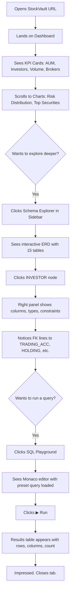
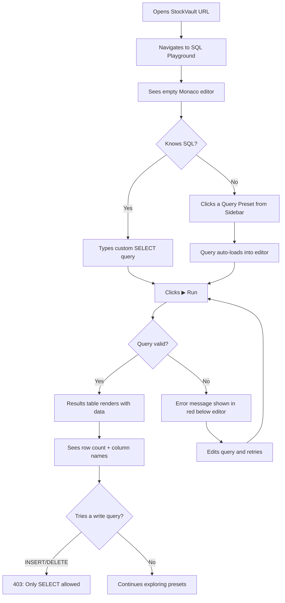
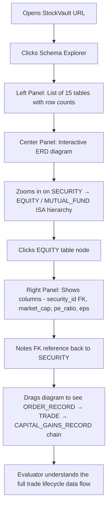

# StockVault Dashboard — App Flow & User Journey

---

## 1. High-Level Navigation Map

```
┌─────────────────────────────────────────────────────────┐
│  STOCKVAULT DASHBOARD                                    │
│                                                          │
│  ┌──────────────┐    ┌────────────────────────────────┐ │
│  │   SIDEBAR     │    │          MAIN CONTENT           │ │
│  │              │    │                                │  │
│  │  🏠 Dashboard │ →  │  [Analytics Stats Grid]         │ │
│  │              │    │  [Charts & Visualizations]      │ │
│  │  <> SQL      │ →  │  [Monaco Editor + Results]      │ │
│  │   Playground │    │                                │  │
│  │              │    │                                │  │
│  │  🔍 Schema   │ →  │  [ERD + Table Inspector]        │ │
│  │   Explorer   │    │                                │  │
│  │              │    │                                │  │
│  │  📊 Analytics│ →  │  [Charts Page]                  │ │
│  │              │    │                                │  │
│  │  ─────────── │    │                                │  │
│  │  PRESETS     │    │                                │  │
│  │  • Financial │ →  │  [Loads query in Playground]    │ │
│  │  • Portfolio  │    │                                │  │
│  │  • Trading   │    │                                │  │
│  │              │    │                                │  │
│  │  ─────────── │    │                                │  │
│  │  ⚙ Settings  │ →  │  [Connection Status + Info]     │ │
│  │              │    │                                │  │
│  │  🟢 PG Online│    │                                │  │
│  └──────────────┘    └────────────────────────────────┘ │
└─────────────────────────────────────────────────────────┘
```

---

## 2. User Journeys

### Journey 1: First-Time Visitor (Interviewer / Evaluator)



**Time to "wow" moment:** < 10 seconds (KPI cards load on first page)

---

### Journey 2: Query Explorer (Data Analyst / Student)



---

### Journey 3: Schema Reviewer (DBMS Evaluator)



---

## 3. Page-by-Page Flow

### 3.1 Dashboard (Home)

**Entry Point**: Default landing page (`/`)

| Step | Action | System Response |
|------|--------|-----------------|
| 1 | Page loads | `GET /api/analytics` fires |
| 2 | — | KPI cards render with animated count-up |
| 3 | — | Charts load: risk distribution pie, top securities bar, sector donut |
| 4 | User hovers a chart segment | Tooltip shows detailed value |
| 5 | User clicks "View Details" on a KPI | Navigates to relevant detail page |

### 3.2 SQL Playground

**Entry Point**: Sidebar click → `/playground`

| Step | Action | System Response |
|------|--------|-----------------|
| 1 | Page loads | Empty Monaco editor with `SET search_path TO trading;` placeholder |
| 2 | User types SQL or clicks a Preset | Query appears in editor |
| 3 | User clicks ▶ Run (or Ctrl+Enter) | `POST /api/sql` with query body |
| 4a | Valid SELECT | Results table renders below editor |
| 4b | Invalid/write query | Error banner shown with PostgreSQL error message |
| 5 | User sees results | Row count badge + column headers displayed |

### 3.3 Schema Explorer

**Entry Point**: Sidebar click → `/schema`

| Step | Action | System Response |
|------|--------|-----------------|
| 1 | Page loads | `GET /api/schema` + `GET /api/schema/relationships` fire |
| 2 | — | Left panel: table list renders |
| 3 | — | Center panel: ERD diagram renders with nodes + FK edges |
| 4 | User clicks a table in the left panel | ERD centers on that table; right panel shows column details |
| 5 | User clicks an FK edge | Navigates to the referenced table |
| 6 | User drags/zooms the ERD | Pan and zoom with mouse |

### 3.4 Analytics (Deep Charts)

**Entry Point**: Sidebar click → `/analytics`

| Step | Action | System Response |
|------|--------|-----------------|
| 1 | Page loads | Multiple `GET /api/analytics/*` endpoints fire |
| 2 | — | Full-width charts render: broker performance comparison, sector allocation, order type distribution |
| 3 | User hovers chart elements | Animated tooltips with values |

---

## 4. Data Flow Diagram

```
User Action                     Frontend                 Backend                  Database
───────────                     ────────                 ───────                  ────────
Loads Dashboard          →   React renders shell   →   GET /api/analytics   →   SELECT COUNT(*) ...
                         ←   KPI cards update      ←   JSON response        ←   Result rows

Types query + Run        →   POST body: {query}    →   POST /api/sql        →   pool.query(sql)
                         ←   Table renders          ←   {rows, fields}      ←   Result rows

Opens Schema Explorer    →   React renders panels  →   GET /api/schema      →   information_schema
                         ←   ERD + inspector        ←   {schema: {...}}     ←   tables + columns
```

---

## 5. Error Handling Flow

| Error Scenario | User Sees | Technical Detail |
|---------------|-----------|-----------------|
| Database offline | 🔴 "Database Offline" badge in sidebar + error toast | `GET /api/health` returns 500 |
| Forbidden query (INSERT, DROP) | Red error banner: "Only SELECT statements are allowed" | Backend returns 403 |
| Invalid SQL syntax | Red error banner with PostgreSQL error message | Backend returns 400 with `error.message` |
| API unreachable | Loading spinner → "Connection Error" toast after 5s timeout | `fetch` throws `TypeError: Failed to fetch` |
| Empty result set | "No rows returned" message in results area | Backend returns `{ rows: [], rowCount: 0 }` |
