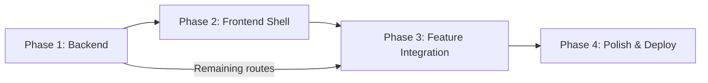

# StockVault Dashboard — Full Implementation Plan

---

## Overview

This plan transforms the StockVault PostgreSQL database project into a full-stack interactive DBMS Explorer. We build in **3 sequential phases**, with each phase producing a deployable increment.

---

## Phase 1: Backend Foundation ✅ COMPLETED

### 1.1 Project Initialization ✅
- [x] Create `backend/` directory
- [x] `npm init -y` + install `express`, `pg`, `cors`, `dotenv`
- [x] Create `.env` with `DATABASE_URL` and `PORT`

### 1.2 Database Connection ✅
- [x] `backend/db.js` — PostgreSQL connection pool via `node-postgres`
- [x] SSL support for Neon.tech deployment

### 1.3 API Routes ✅
- [x] `GET /api/analytics` — KPI metrics (AUM, investors, brokers, volume)
- [x] `GET /api/schema` — Table + column introspection from `information_schema`
- [x] `POST /api/sql` — Read-only SQL execution with safety validation

### 1.4 Remaining Backend Work
- [ ] `GET /api/health` — Database connectivity check + PG version
- [ ] `GET /api/analytics/risk-distribution` — Investor count grouped by `RISK_PROFILE`
- [ ] `GET /api/analytics/top-securities` — Top 5 securities by total holding value
- [ ] `GET /api/analytics/broker-performance` — Broker metrics from `v_broker_performance`
- [ ] `GET /api/analytics/sector-allocation` — Sector-wise allocation from `HOLDING` + `SECURITY`
- [ ] `GET /api/schema/relationships` — FK constraints for ERD edges
- [ ] `GET /api/presets` — Return categorized list of all 30 preset queries
- [ ] Add `nodemon` dev script to `package.json`
- [ ] Add security hardening: reject `DROP`, `ALTER`, `TRUNCATE`, `CREATE`, `INSERT`, `UPDATE`, `DELETE` in SQL playground

---

## Phase 2: Frontend Foundation

### 2.1 Project Setup
- [ ] Initialize `frontend/` with `npx create-vite@latest ./ --template react`
- [ ] Install dependencies:
  - `tailwindcss`, `postcss`, `autoprefixer` (styling)
  - `recharts` (charts)
  - `@monaco-editor/react` (SQL editor)
  - `@xyflow/react` (ERD diagram)
  - `framer-motion` (animations)
  - `lucide-react` (icons)
  - `react-router-dom` (routing)
- [ ] Configure Tailwind CSS with custom dark theme tokens from `design.md`
- [ ] Add Google Fonts (Inter, JetBrains Mono)

### 2.2 App Shell & Layout
- [ ] Create root layout with Sidebar (240px) + Main Content area
- [ ] Build `Sidebar` component:
  - Logo ("STOCK" + "VAULT" in gold)
  - Navigation items: Dashboard, SQL Playground, Schema Explorer, Analytics
  - Section dividers
  - Query Presets section (collapsible)
  - Settings link
  - PostgreSQL connection status indicator (🟢/🔴)
- [ ] Build `TickerBar` component — scrolling security prices across the top
- [ ] Set up React Router with routes: `/`, `/playground`, `/schema`, `/analytics`, `/settings`

### 2.3 Shared Components
- [ ] `GlassCard` — Reusable glassmorphism card wrapper
- [ ] `StatCard` — KPI stat card with icon, value, label, delta badge
- [ ] `DataTable` — Sortable, paginated table for SQL results
- [ ] `LoadingSpinner` — Animated loading state
- [ ] `ErrorBanner` — Red error display with shake animation
- [ ] `Toast` — Slide-in notification component

---

## Phase 3: Feature Integration

### 3.1 Dashboard Page (`/`)
- [ ] Fetch `/api/analytics` on mount
- [ ] Render 4 `StatCard` components with count-up animation
  - Total AUM (₹ formatted)
  - Active Investors
  - Trading Volume
  - Active Brokers
- [ ] Fetch and render charts:
  - Risk Profile Distribution (Pie/Donut chart)
  - Top 5 Securities (Horizontal bar chart)
  - Broker Performance Comparison (Bar chart)
  - Sector Allocation (Donut chart)

### 3.2 SQL Playground Page (`/playground`)
- [ ] Integrate `@monaco-editor/react` with `vs-dark` theme
- [ ] Add Run button (▶) with gradient styling
- [ ] Wire up `POST /api/sql` on Run / Ctrl+Enter
- [ ] Render results in `DataTable` with row count badge
- [ ] Display errors in `ErrorBanner`
- [ ] Build Query Preset sidebar panel:
  - Load all 30 queries from `/api/presets`
  - Group by category (Financial, Portfolio, Trading)
  - Click to load into editor + auto-execute

### 3.3 Schema Explorer Page (`/schema`)
- [ ] **Left Panel**: Fetch `/api/schema`, render searchable table list with row counts
- [ ] **Center Panel**: Build React Flow ERD
  - Custom `TableNode` component for each table
  - FK edge connections with animated dashes
  - ISA hierarchy visualization
  - Pan, zoom, minimap controls
- [ ] **Right Panel**: Column inspector
  - Shows column name, data type, nullable, key type (PK/FK/UQ)
  - Slides in when a table is selected

### 3.4 Analytics Page (`/analytics`)
- [ ] Deep-dive charts page with full-width visualizations
- [ ] Broker leaderboard table
- [ ] Order type distribution chart
- [ ] Fund transaction timeline

### 3.5 Settings Page (`/settings`)
- [ ] Display connection status from `/api/health`
- [ ] Show PostgreSQL version, schema name, table count
- [ ] Database URL (masked)

---

## Phase 4: Polish & Deploy

### 4.1 Animations
- [ ] Page transitions (fade + slide) via Framer Motion
- [ ] KPI card mount animations (scale + fade)
- [ ] Chart entry animations (grow from 0)
- [ ] Skeleton loading states for all data-fetching components

### 4.2 Error Handling
- [ ] Global error boundary component
- [ ] API timeout handling (5s timeout)
- [ ] Graceful degradation when database is offline

### 4.3 Deployment
- [ ] Set up Neon.tech database with seed data
- [ ] Deploy backend to Render.com (free tier)
- [ ] Deploy frontend to Vercel (free tier)
- [ ] Update environment variables for production URLs
- [ ] Test full end-to-end flow on deployed URLs

### 4.4 Documentation
- [ ] Update `README.md` with screenshots, setup guide, and deployed URL
- [ ] Create `docs/API.md` documenting all backend endpoints
- [ ] Ensure all docs are cross-linked

---

## Dependency Order

> **Note**: Phase 1 remaining routes (analytics sub-endpoints, schema relationships, presets) can be built in parallel with Phase 2 frontend setup, since the frontend won't need them until Phase 3.

---

## Estimated Timeline

| Phase | Scope | Estimated Effort |
|-------|-------|-----------------|
| Phase 1 (remaining) | 8 additional API routes + security hardening | 2–3 hours |
| Phase 2 | Vite + Tailwind + Router + Shell + Shared components | 3–4 hours |
| Phase 3 | Dashboard + Playground + Schema Explorer + Analytics | 6–8 hours |
| Phase 4 | Animations, error handling, deployment, docs | 2–3 hours |
| **Total** | | **13–18 hours** |
